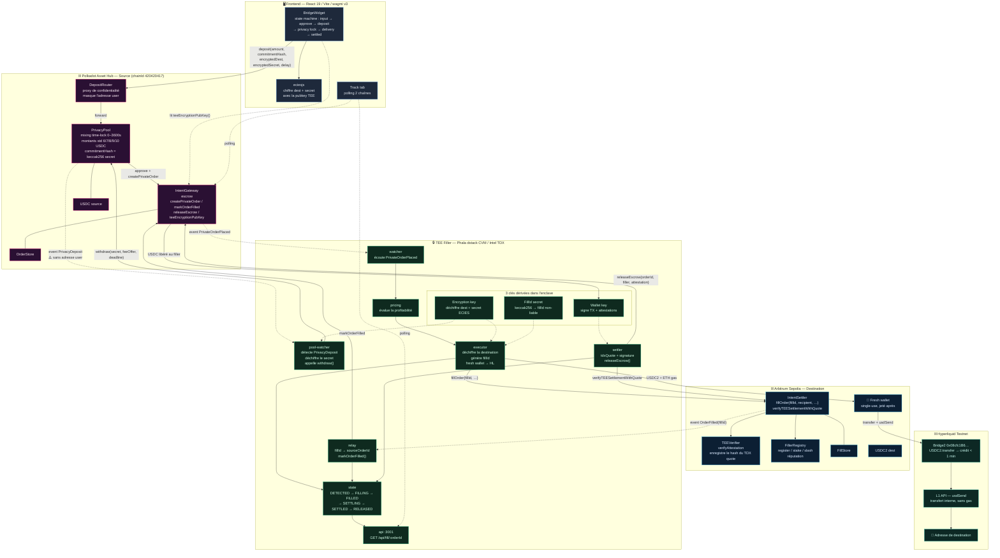
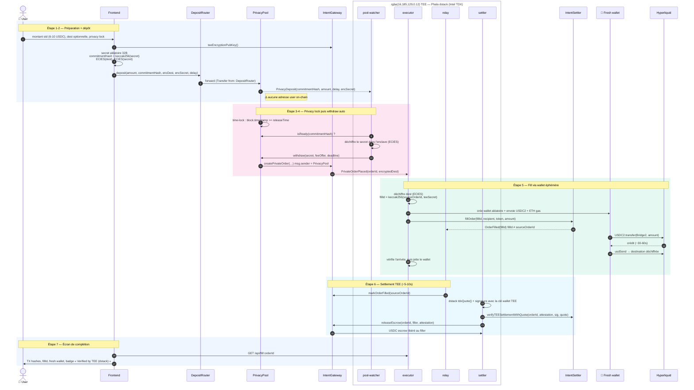
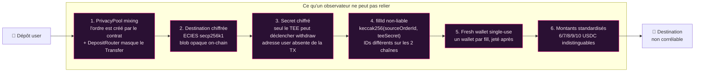
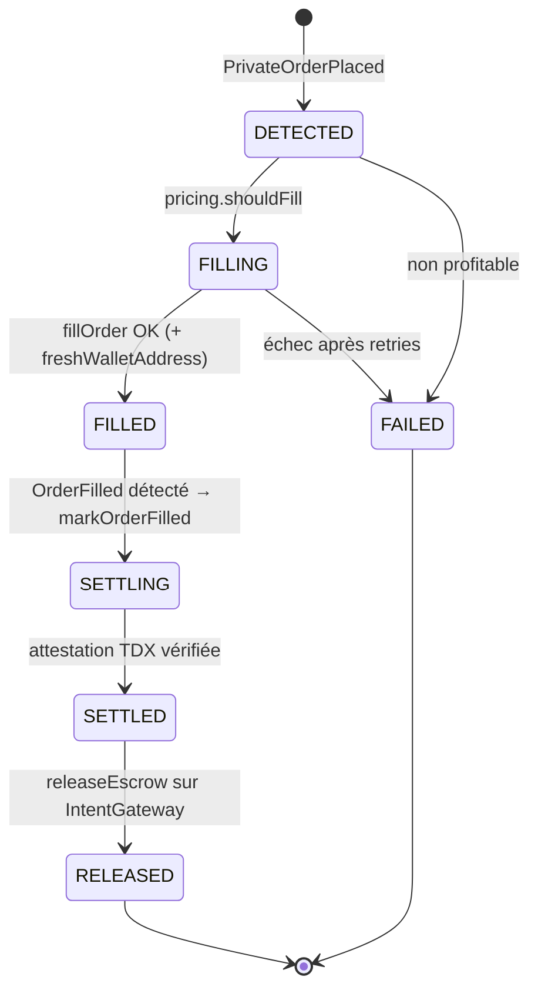
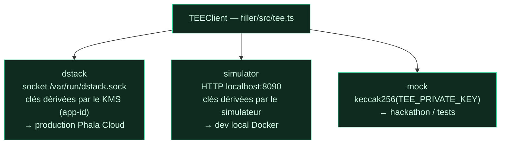

# Velora — Architecture

## 1. Vue d'ensemble des composants

---

## 2. Flux complet (séquence, 7 étapes)

---

## 3. Modèle de confidentialité — 6 couches

---

## 4. Cycle de vie d'un ordre (`filler/src/state.ts`)

---

## 5. Modes TEE

